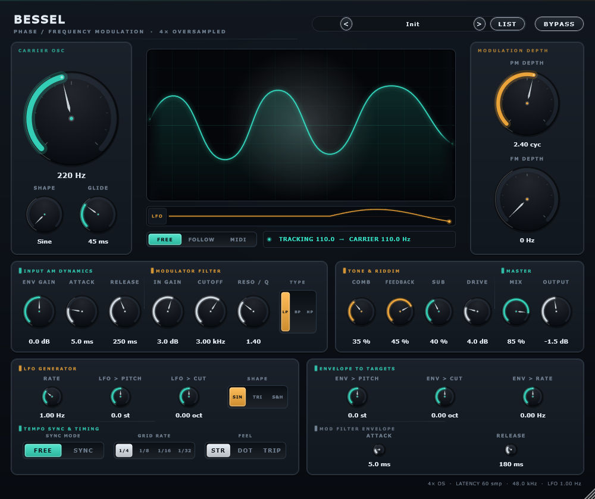
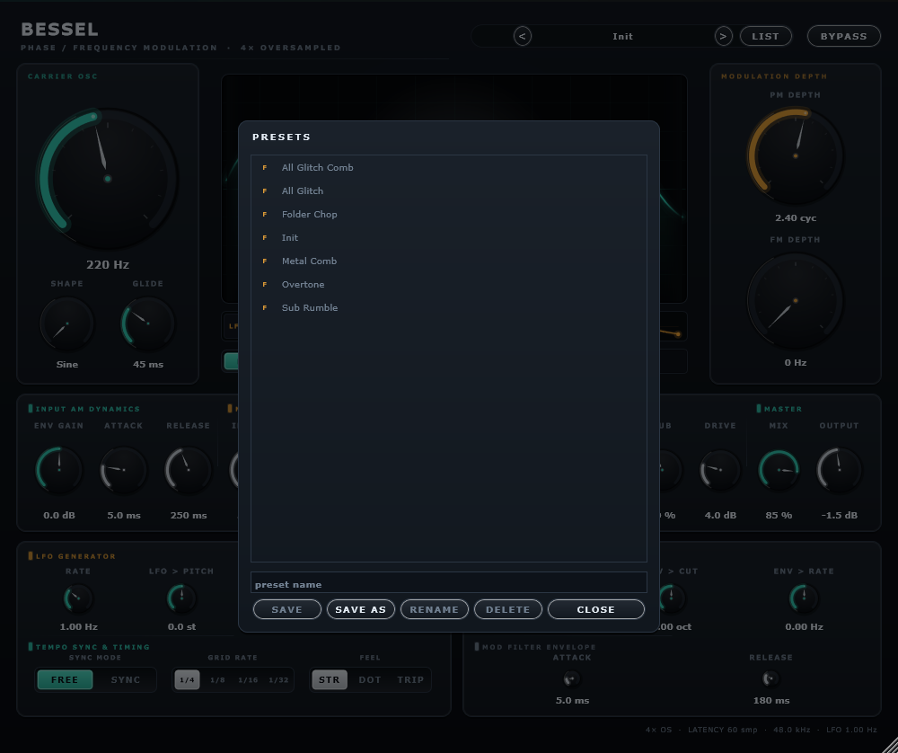

# Bessel — 相位 / 频率调制载波效果器

**License: AGPL-3.0** · **Platform: Windows x64 (VST3)** · **JUCE 9** · **v0.3.0**

> A VST3 effect that turns any audio into a **harmonic generator**: your material drives
> the phase/frequency of an internal carrier through true PM/FM, while its own volume
> envelope gates the output. No input, no sound. No keyboard required.



## 它能做什么

| | |
|---|---|
| **真 PM + 真 FM，可同时开** | PM 不动音高（干净重合成），FM 动音高（撕裂、下潜）。两个量独立，等于给调制源加 1/f 倾斜 |
| **4× 过采样** | 深 PM 的贝塞尔边带会折到 Nyquist 以上。实测温和深度下 4× 比 1× 干净 **57 dB** |
| **真立体声** | 左右声道的滤波器与相位累加器完全独立，不是复制一份 |
| **带限波表载波** | 正弦 → 三角 → 带限锯齿**连续形变**；按 Nyquist 自动降谐波数，深 PM 不爆裂 |
| **0 Hz = Wavefolder** | 载波拧到 DC，输出变成 `wave(调制信号)`，一台素材驱动的波形整形器 |
| **MIDI 追踪梳状滤波** | 把 PM 炸出的宽频噪波对齐到谐波列：正反馈全谐波，负反馈只剩奇次 |
| **调制矩阵** | LFO（可同步 BPM）+ 输入包络 → 音高 / 滤波截止 / LFO 速率 |
| **干净 sub + 软削波** | 补回被 `J₀` 抽空的基频，再把上层纹理焊死在 sub 周期上 |
| **7 个工厂预设 + 预设浏览器** | 文件在 `%APPDATA%\Bessel\Presets`，Factory / User 分离 |



## 快速开始

**用现成包**：下载 release 里的 `Bessel-*-win64.zip`，解压，把整个 `Bessel.vst3` 文件夹拷到

```
%LOCALAPPDATA%\Programs\Common\VST3\
```

然后在宿主里重扫插件。包是静态链接 CRT 的，不需要装 VC++ 运行库。

**自己编译**：

```powershell
cmake -S . -B build -G Ninja -DCMAKE_BUILD_TYPE=Release
cmake --build build --parallel
```

JUCE 会自动拉取（本地有 `../JUCE` 就直接用）。

## 文档

- [参与开发](CONTRIBUTING.md) — 构建、测试、提交约定
- 下面这一整篇是**实现内幕**：为什么这么做、踩过哪些坑、每个参数的物理意义

## 许可与致谢

本项目以 **AGPL-3.0** 发布（见 [LICENSE](LICENSE)）。它依赖两套同样是双授权的框架：

- **JUCE 9** — AGPLv3 / 商业授权。本项目走 AGPLv3 分支。
- **VST3 SDK** — GPLv3 / Steinberg 授权。同样走 GPLv3 分支。

如果你要在闭源或商业产品里用这份代码，需要自行取得 JUCE 与 Steinberg 的商业授权。

---

外部音频进来，**分成两路**：一路滤波后当调制源去调制内部载波（PM 或 FM 可选），
一路取音量包络做 AM。所以它没有输入时不出声、输入多大输出就多大——
本质是一台**用素材驱动的谐波发生器**，适合把原素材的纹理提出来做 sub 层 / 打击层。

```
外部音频 ─┬─→ [包络跟随] ──────────────────────────┐
          │                                    (AM 增益)
          └─→ [Mod Gain] ─→ [SVF: LP/BP/HP] ─→ 调制量 m
                                                    ↓
                    载波 sin/saw ←── PM: wave(phase + index × m)
                                      FM: phase += inc + m × 500 Hz
                                                    ↓
                     [Mix] ─→ [Output] ─→ [× AM] ─→ 输出
```

跑的是一套「用一个声音去雕刻另一个声音」的逻辑，不是 vocoder：输出是内部载波，
外部音频只负责*推相位*，所以出来的谐波结构完全由载波和调制度决定。

同一个输入信号干两件事：**滤波后当调制源**（改音色），**取包络当 AM 增益**（改音量）。
所以没有输入时不会有任何声音漏出来，输入多大输出就多大——原因见下面「输入包络」一节。

---

## 三条硬约束（改代码时别破坏）

### 1. PM 是默认，FM 是可选

```cpp
// PM：调制只加到读相位上，累加器不受影响
readPhase = phase + index * mod;
out = wave (readPhase);

// FM：调制加进相位步长（可切换，代价是直流会推走音高）
step = inc + index * mod * 500Hz / sr;
```

外部音频常有直流偏移。FM 下那段直流会变成持续的频率偏移，**载波音高直接跑掉**；
PM 下它只是一个静态相位偏移，音高分毫不动。所以 **PM 是默认模式**。

FM 开关是给想要那种不稳定感的人用的。T10 把这个差别量化了：0.3 的纯直流 + index 4 时，
PM 稳定在 **440.06 Hz**，FM 精确偏到 **1040.14 Hz**（= 440 + 4×0.3×500）。

### 2. 4 倍过采样

音频速率 PM 产生贝塞尔边带，高次边带能冲到几十 kHz。不升频就在 44.1/48 kHz 下
折叠回来，听感是廉价的数码杂音。

整条链跑在 4 倍采样率上，抽取用 FIR 等波纹半带滤波（`filterHalfBandFIREquiripple`），
延迟 60 个样本，已通过 `setLatencySamples()` 如实上报。
旁通时也照样走一遍上/下采样——否则旁通那一刻这条轨会比别的轨提前 60 个样本。

### 3. 真立体声

`Svf::st[2]` 和 `PmOscillator::phase[2]` 都是按声道分开存的。
共用一份状态会把立体声宽度压扁，这是这类效果器最常见的偷懒。

---

## PM 与 FM 可以同时开

两个调制量各自独立，同时加在同一个相位上：

```
读出相位 = φ₀ + f₀t + PM量 × m(t) + FM量 × ∫m(t)dt
```

**这不是"两种效果叠加"，而是给调制源加了一条 1/f 倾斜。** 把 ∫ 理解成频域里除以 jω 就清楚了：

- **PM 那一份**照原样放大调制信号——锐利、谐波对称，音高稳
- **FM 那一份**只放大调制信号的低频——滑、被低频拖着走、会改音高

所以两个旋钮其实是一对**调制频谱的倾角控制**：PM 越多越干净，FM 越多越"沉"。

单位不同，这是必须分开的原因：

```
PM: 相位偏移，单位「圈」
FM: 频率偏移，1 单位 = 500 Hz（绝对 Hz，换采样率手感一致）
```

相位步长钳在 ±0.45 圈/采样：再往外就是噪声了，4x 过采样也救不回来。

**什么时候用哪个：**

| | PM | FM |
|---|---|---|
| 音高稳定 | ✅ 直流偏移不影响 | ❌ 直流 → 持续频偏 |
| 声音性格 | 干净、谐波对称 | 更"模拟"、会飘、有下坠感 |
| 适合 | sub 层、纹理层、要跟原素材对得上 | 不稳定的金属、失控感、噪音墙 |
| 两个一起开 | 明亮边带 + 缓慢音高漂移，"不稳定的金属" | |

FM 给一点就够（0.5–2），并且建议把 `Mod Filter` 设成 High Pass 或压低 `Mod Gain`——
低频的直流和隆隆声会直接变成音高抖动。

**测试**（T10）验证了独立性：直流 0.3 时，只开 FM 4 → 1040.14 Hz；**PM 4 和 FM 4 同时开仍是
1040.14 Hz**——PM 再怎么加都不动音高，只改音色。

---

## 混叠实测

`PmEffectTest` 的 T7 直接量：调制器 15 kHz，载波 227 Hz，看 2773 Hz 上的折叠分量
（`227 + 3×15000 = 45227`，在 48 kHz 下折回 2773）。

| PM 深度 | 4x 相对 1x 的抑制 | 限制来自 |
|---|---|---|
| index 1.0（6.3 弧度） | **57.2 dB** | 抽取滤波器阻带，正常 |
| index 4.0（25 弧度） | **19.9 dB** | 4x 内部自己的 k=13 折叠 |

第二条值得记：`192000 − |227 − 13×15000| = 2773`。
深度拉到 25 弧度时贝塞尔级数拖到十几阶，即使 192 kHz 内部也会折回同样的频点。
**这是 PM 的固有上限，不是滤波器没做好**——深调制想要更干净只能上 8x
（把 `PluginProcessor.h` 的 `oversamplingPower` 改成 3），代价是 CPU 和延迟翻倍。

---

## 参数

| 参数 | 范围 | 说明 |
|---|---|---|
| **Env Gain** | −24 – +24 dB | 包络的整体增益：提安静素材 / 压响素材。AM 本身恒满 |
| **AM Attack** | 1 – 100 ms | 包络起音，短 = 打击感 |
| **AM Release** | 30 – 2000 ms | 包络释放，长 = 呼吸感 |
| Carrier | **DC + 20 – 5000 Hz** | 载波频率。**底部是 DC 卡位**（相位不自走，输出 = wave(调制信号) = Wavefolder）；1–20 Hz 死区已被移除；跟随/MIDI 时是回退值 |
| **Shape** | 0 – 100% | 连续形变：**Sine → Triangle → 带限 Saw**。峰值归一化，形变时音量不跳 |
| PM Amount | 0 – 8 圈 | 相位调制深度。只改音色，不动音高 |
| FM Amount | 0 – 4000 Hz | 频率调制深度。会改音高，直流会让它跑 |
| Modulation | — | 两个量同时生效，等价于给调制源加 1/f 倾斜 |
| Mod Gain | ±24 dB | 调制信号进滤波器之前的电平 |
| Mod Filter | LP / BP / HP | TPT 状态变量滤波，每声道独立状态 |
| Mod Freq | 20 – 20000 Hz | 调制滤波截止 |
| Mod Q | 0.3 – 12 | |
| Mix | 0 – 100% | 干湿 |
| Output Gain | ±24 dB | |
| **Pitch Source** | Free / Follow / MIDI | 载波音高从哪来，见「Riddim 层」一节 |
| **Glide** | 1 – 500 ms | 换音高时的滑音时间（三种模式都生效） |
| **Comb** | 0 – 100% | MIDI 追踪梳状滤波的混入量；0 = 完全旁通 |
| **Comb FB** | −98 – +98% | 反馈量。**正值 = 全谐波；负值 = 只留奇次谐波（空心 Square4 味）** |
| **Clean Sub** | 0 – 100% | 同相纯正弦混入量，补回被 PM 抽空的基频 |
| **Drive** | 0 – 18 dB | 4x 域内 tanh 软削波；0 dB = 完全旁通 |
| **LFO Rate** | 0.01 – 50 Hz | 自由运行 LFO。高到音频速率就是第二路 FM |
| **LFO Shape** | Sine / Tri / S&H | S&H = 每个周期换一个随机值 |
| **LFO>Pitch** | ±48 半音 | LFO 推载波音高：颤音 / 警报 / riser |
| **LFO>Cut** | ±6 八度 | LFO 推调制滤波截止：哇音 / 共振峰扫动 |
| **LFO Sync** | Free / Sync | Sync = 跟工程 BPM，忽略 Rate 旋钮 |
| **LFO Grid** | 1/4 – 1/32 | 同步时的音符长度 |
| **Grid Mod** | Straight / Dotted / Triplet | 附点 ×1.5、三连 ×2/3 |
| **Env>Pitch** | ±48 半音 | 输入包络推载波音高（音量越大音越高 = 合成器感） |
| **Env>Cut** | ±6 八度 | 输入包络推滤波截止 = 自动哇音 |
| **Env>Rate** | ±4 八度 | 输入包络推 LFO 速率（越响颤音越快） |
| （Bypass） | — | 走宿主自己的旁通按钮 |

参数全部走 APVTS，`processBlock` 里只读缓存的原子指针。

---

## Riddim 层：MIDI / 梳状 / Sub

三件事把 Bessel 从"纹理效果器"推到"能弹的重合成器"。仍然是**效果器身份**：
挂在音频轨的 FX 槽里吃外部素材，同时接收 MIDI 音符。

### 1. Pitch Source：三档音高来源

| 档位 | 载波频率来自 | 用在哪 |
|---|---|---|
| **Free** | `Carrier` 旋钮 | 固定音高的纹理 / 打击层 |
| **Follow** | YIN 跟踪外部素材 | 素材本身有明确音高时 |
| **MIDI** | 宿主发来的音符 | **Riddim**：用 MIDI 定音高，音频定节奏 |

- MIDI 档：单音、late-note priority（后按的覆盖前按的）、弯音 **±12 半音**（一个八度）
- Note-On 会**复位载波相位**并做 1 ms 淡入 —— 每一拍的低频冲击相位一致
- 没有按住的音时回落 `Carrier` 旋钮值（它仍是效果器，不是非按不可的合成器）

> ⚠️ 宿主支持情况不同：Bitwig / Cubase / Live 可以直接往 FX 送 MIDI；
> **REAPER 要手动在 FX 窗口打开 MIDI 输入**，否则音符进不来。

### 2. MIDI 追踪梳状滤波（Comb / Comb FB）

```
y[n] = x[n] + g · LP(y[n−D]),    D = fs / (载波频率)
```

PM 拉满之后输出是宽频的非谐波噪波，人耳抓不到音高。梳状滤波把延迟锁在载波周期上，
所有噪点被**强迫对齐到整数倍谐波**——这就是金属喉音的来源。

- **Comb FB > 0**：全整数倍谐波，厚重 / 锯齿 / 金属管
- **Comb FB < 0**：只留奇次谐波，空心 / 方波感
- 反馈环里串了 14 kHz 阻尼低通，否则高反馈会在超高频自己啸叫
- 分数延迟用线性插值（不做的话高音区明显走音）
- 跑在 4x 域内（192 kHz），40 Hz 只需要 4800 个延迟样本，开销可忽略

### 3. Clean Sub + Drive

大深度 PM 会让贝塞尔 `J₀` 把载波基频抽空——听起来凶，但底盘发飘。

- **Clean Sub**：一条**不受 PM/FM 影响**的同相正弦，乘同一个包络，混回输出
- **Drive**：把 sub 和 PM 支路汇合后，在 4x 域里过 `tanh`。互调让上层纹理焊死在底层 sub 的周期上，听感是一个整体而不是两层

**测试**（T11–T13）：MIDI 40 → 82.4 Hz、52 → 164.8 Hz、弯音 +12 st → ×2、松键回落 500 Hz；
梳状滤波正反馈 **4.95×**、负反馈 **0.56×**；Clean Sub 把 60 Hz 能量提 **7.3 倍**；
Drive 把峰值 **1.997 → 1.000**。

> [!warning] 开 MIDI 输入会带来 2080 个隐形参数
> JUCE 的 VST3 包装层有个默认行为：`JucePlugin_WantsMidiInput` 为真时，
> 它会把**每个 MIDI CC 都映射成一个自动化参数**（16 通道 × 128 CC）。
> 参数总数会从 20 直接涨到 **2100**，在 Cubase 里打开自动化列表会卡死。
>
> 修法：`add_compile_definitions(JUCE_VST3_EMULATE_MIDI_CC_WITH_PARAMETERS=0)`。
> 这个坑只有跑一次「宿主视角参数计数」才会暴露——所以 `PluginScanTest` 里那条
> `count == 20` 的断言是必需的，别当成形式主义。

---

## LFO：第一块「自己会动」的调制

之前插件没有任何自动调制源——想让音高或音色随时间变化，只能在宿主里画自动化。
LFO 把这件事搬进插件内部：

| 目标 | 听感 | 典型设置 |
|---|---|---|
| **LFO → Pitch** | 颤音、警报、riser、下潜 | Rate 0.2–1 Hz，深度 2–12 st |
| **LFO → Cutoff** | 哇音、共振峰移动、越来越开 | Rate 0.1–4 Hz，深度 2–4 oct |

实现要点：

- **相位每采样推进**（精确），但音高倍率和截止**每 32 采样才应用一次**（4x 域 = 0.167 ms）。
  这样 `exp2` / `tan` 不用进采样循环，又快又平滑。
- 截止用 `exp2(lfo × 八度)` 乘在基准值上，所以是**等比扫频**，听感线性。
- 音高走 `exp2(lfo × 半音 / 12)`，乘在振荡器的相位增量上。
- Rate 到 50 Hz 时它已经接近音频速率——可以当第二个调制器用（实验性）。

### 实时波形带

示波器下面那条琥珀色带子画的是 **LFO 最近 1.5 秒的实际输出**：

- 波的**疏密** = 当前速率。`ENV>RATE` 一推，密度当场变——不用靠耳朵猜有没有生效
- **形状** = SIN / TRI / S&H
- 右端光点 = 此刻的 LFO 值，也就是此刻推到音高 / 截止的量

数据直接从 PmEffect 内部的 800 Hz 降采样环形缓冲取，不占额外音频线程算力。

**测试**（T14）：0.25 Hz、+12 st 时，峰值处载波精确翻倍（400.00 Hz）；截止 +5 八度时
8 kHz 调制源从进不来变成进得来，200 Hz 基频能量 0.25 → 0.10（被 PM 抽走），证明扫频真的作用在信号路径上。

---

## 调制矩阵：两个源 × 三个目的地

```
        LFO（自由/同步）──┐
                          ├──→ 载波音高（半音）
        输入包络（0–1）───┤    ──→ 滤波截止（八度）= MOD FREQ
                          └──→ LFO 速率（八度）
```

- 两个源的调制量**相加**，都按等比（`exp2`）应用，所以听感线性
- **包络是归一化的**（0–1，不含 Env Gain）——Gain 旋钮只改音量，不会顺手改调制深度
- 三个目的地里，**Env>Rate 最有趣**：素材越响 LFO 跑得越快，颤音会跟着素材"急起来"
- LFO 同步：`rate = (BPM / 60) / (音符长度 × 附点/三连系数)`。120 BPM 的 1/8 = 4 Hz

**测试**（T15）：注入恒定包络 0.5、深度 24 st → 载波 200 → **399.74 Hz**；
包络 0 → 199.22 Hz（不动）。两个源的相加关系就这样被钉住了。

---

## 载波：带限波表 + 0 Hz 折叠

### 为什么换掉几何锯齿

传统锯齿的相位单向递增，每周期只过一次 `2π→0` 跳变点。
**深 PM 下总相位会高速往返**，一旦在跳变沿附近震荡，几毫秒内会连续触发几十次阶跃
—— 听感就是电流爆裂 + 剧烈混叠，4x 过采样也压不住，因为问题不在采样率，在跳变本身。

现在的做法：**带限波表 + mipmap**。

| | |
|---|---|
| 表 | 2048 点 × 3 形状（Sine / Tri / Saw）× **8 档谐波数**（128 / 64 / 32 / 16 / 8 / 4 / 2 / 1） |
| 选档 | 按载波频率挑「最亮且不超过 0.45×Nyquist」的那一档 |
| 读取 | 线性插值；形变用两表交叉淡化 |
| 归一化 | 每张表峰值归一到 1.0，形变/换档时不会跳音量 |

带限表是**连续函数**，没有那个跳变点，所以深 PM 下不会爆裂。

### 1–20 Hz 是死区，被做成了卡位

一开始我把载波做成 0–5000 连续，结果 `1–20 Hz` 那一段只会产生**听不见的亚声波**：
那么慢的载波撑不出可听音高，只是往频谱底部堆能量、占动态余量。

现在旋钮的底部 3% 行程**全部吸附到 DC**，其余是 20 Hz–5 kHz 的对数区。
所以 `DC / Folder` 是一个真正的档位，而不是"0.3 Hz 这种中间值"。

### 0 Hz = Wavefolder

把 `Carrier` 拧到 0，相位不再自己走：`输出 = wave(PM × 调制信号)`。
这时候它不再是振荡器，而是一台 **Wavefolder / Rumble 发生器**：

- 正弦形变 → 正弦整形，只出**奇次**谐波（实测 200 Hz 输入 → 3 次谐波 0.094，偶次为 0）
- 三角 / 锯齿形变 → 折叠出更复杂的谱
- 配上 `ENV>Pitch`、`LFO>Cut`，就是一台被素材驱动的波形整形器

**测试**（T20 / T21）：锯齿 2 次谐波/基频 = **0.50**（理论 1/2）；三角无偶次；
0 Hz 模式下基频 0.101、3 次 0.094，折叠确实发生。

### DC / 亚声波高通

PM 和 Folder 都会在 20 Hz 以下堆能量。输出串了**两级一阶高通（≈15 Hz）**：

| 频率 | 衰减 |
|---|---|
| 5 Hz | **−19.5 dB**（实测 0.27 → 0.07） |
| 60 Hz | −0.4 dB（实测 0.664） |

单级 12 Hz 只压 −8 dB，不够；两级之后 40 Hz 以上的低频基本无损。

---

## 输入包络 → AM（没输入就不出声）

这个插件内部有一个常开的载波，所以「没有输入时闭嘴」只能靠**输入自身的音量包络**。
用法是：**去干信号，把包络乘到湿信号上，恒满，永远。**

一开始写的是带阈值的二值门，后来改成 AM：

| | 二值门 | AM（现方案） |
|---|---|---|
| 判断 | 电平 > 阈值 → 开 | 输出 = 载波 × 包络 |
| 小信号 | 要么全开要么全关 | 自然变小 |
| 阈值附近 | 会抖，要加迟滞 | 没有这个概念 |
| 打击乐 | 尾音被切死 | 顺着衰减 |
| 参数 | 阈值 + 释放 | 包络增益 + 攻击 + 释放 |

### 为什么没有「深度」旋钮

第一版有个 `AM Depth`，公式是 `增益 = (1 − depth) + depth × 包络`。
**这个公式天生会漏**：只要 depth 不是 100%，静音输入时载波还在以 `1 − depth` 的电平响。
对一个「提取原素材纹理」的插件来说这是错的。

现在公式就是 `增益 = 包络 × 线性增益`，没有干载波通路。`Env Gain` 只缩放包络本身：

- **-24 dB ~ 0 dB**：压。素材很响、不想让 sub 层抢戏时用
- **0 dB**：输出电平 = 素材电平 × 载波
- **0 ~ +24 dB**：提。素材本身很轻（纹理、气声、room tone）时把它提到能听见

### 为什么 AM 只乘在湿信号上

如果把 AM 乘在整个输出上，`Mix < 100%` 时干声会被**自己的包络**调制——
听起来像莫名其妙的泵动和染色。干声是原素材，不该被自己的音量包络再乘一遍。

所以 `PmEffect::process` 里的干湿混合是：

```cpp
wet = 载波 × 包络增益;              // 只有湿信号吃 AM
out = dry + (wet - dry) * mix;
```

### 两个必须守住的实现细节

> [!note] 检测点必须在干信号上
> 输出里永远有载波。拿输出算包络，它会自己撑住自己、永远不衰减——
> 这是「常开振荡器 + 跟随」这类结构最经典的死循环。

> [!warning] 释放不要短于信号周期
> 110 Hz 的周期约 9 ms。释放设到 10 ms 以下，包络会带上 220 Hz 的纹波——
> 那是音频速率的 AM，会凭空多出边带。默认 250 ms，下限 30 ms。

实现见 [InputEnvelope.h](Source/dsp/InputEnvelope.h)：峰值检波 + 单极点平滑，逐采样算增益，
在 4x 过采样里按整数采样保持。

**测试**（T9）实测：无输入 rms = 0.000000（+24 dB 下也是 0）；输入 0.5 → 0.336；
Env Gain +6 dB → 比例 1.995；−12 dB → 0.251；`Mix=0` 时输出 0.3535（= 输入本身，没被 AM）；
停音后先 0.304 再 0.007。

> [!note] 关于「sub 层」还差一步
> 现在 `Follow` 是 1:1 跟随音高。真要做 sub，通常要落在**下方一到两个八度**。
> 加一个 Octave 选择（−2 / −1 / 0）就能直接当 sub 生成器用，还没做。

---

## 载波跟随输入音高

开关。关掉时载波锁在 `Carrier` 旋钮；打开时载波频率跟着输入音高走。

实现是 **YIN 的累积均值归一化差分函数**（[PitchTracker.h](Source/dsp/PitchTracker.h)）：

- 窗口 1024 采样、hop 512、范围 50–1200 Hz
- 跑在**基础采样率**上，不是 4x —— 便宜 4 倍，跟踪精度也够
- 跟到 → 用检测值；跟丢（静音 / 无周期 / 置信度 < 0.35）→ 滑回 `Carrier` 旋钮的值
- 载波频率本身有 30 ms 线性平滑，换音高不会一格一格跳
- 只在开关打开时才喂数据，关掉完全不跑

**为什么不用过零率**：泛音丰富的信号上它会直接数泛音。测试 T8 拿「220 Hz + 前 6 次谐波」
喂进去，过零率法会给 440 甚至 660，YIN 给 **219.89 Hz**。

开销约 9 千万次乘加/秒（单核几个百分点），且只在使用时产生。

### 怎么验证

**① 看界面读数。** FOLLOW 旁边那行字现在显示两个数字：

```
TRACK OFF  ·  CARRIER 500.0 Hz          ← 跟随关，锁在旋钮
TRACKING  220.1  →  CARRIER 220.1 Hz    ← 跟到（两个数字应该相等）
NO PITCH   ·  CARRIER 500.0 Hz          ← 跟丢，回退到旋钮值
```

左边是检测结果，右边是**实际送给振荡器**的频率。两者相等 = 通路正确。

**② 跑诊断工具，看数字。** 先把素材生成到 `test-material/`：

```powershell
python make-test-material.py
pwsh -File build.ps1
build\TrackReport_artefacts\Release\TrackReport.exe
```

输出的表长这样（本机实测）：

| 素材 | 锁定 | 中位音高 | 范围 | 载波中位 | 有效占比 |
|---|---|---|---|---|---|
| 220 Hz 正弦 | 0.19 s | **220.0** | 220.0–220.0 | 220.0 | 100 % |
| 110 Hz 正弦 | 0.19 s | **110.0** | 110.0–110.0 | 110.0 | 100 % |
| 55 Hz 正弦 | 0.19 s | **55.0** | 55.0–55.0 | 55.0 | 100 % |
| 220 Hz + 6 次谐波 | 0.19 s | **220.0** | 220.0–220.0 | 220.0 | 100 % |
| 110→220 滑音 | 0.19 s | 159.0 | 114.6–210.5 | 159.0 | 100 % |
| 白噪声 | — | 0.0 | — | **500.0** | 0 % |
| 两个音的和弦 | 0.19 s | 70.9 ⚠️ | 55.3–253.9 | 70.9 | 100 % |

**③ 在宿主里听。** 把素材拖进工程，`Follow` 开、`PM/FM` 都归零、`Mix 100%`：
载波应该和素材同音高；点掉 `Follow` 立刻跳到 `Carrier` 旋钮的固定值。

### 已知限制（都是设计上的取舍）

- **范围 50–1200 Hz**：低于 50 Hz（比如 30 Hz 的 sub）跟不到，会一直用回退值
- **复音素材会乱**：上表最后一行，两个音的和弦给出的 70.9 Hz 是拍频，不是任何一个音
- **静音时没有输出**（AM 恒开），所以"回退"只有在**有输入但没有音高**时才听得到——白噪声是最好用的测试信号

---

## 界面


全自绘，没有用 JUCE 默认控件外观。好看不靠配色，靠下面四条。

### 1. 材质：每个控件都要有「受光面」

- **面板** = 竖向渐变 + 上沿 1px 高光 + 向下 2px 投影。有这三样才像一块板，而不是一个框
- **旋钮** = 径向渐变凹槽 + 内阴影 + 底部反光弧。光从上来，凹进去的东西就是上暗下亮
- **按钮** = 竖向渐变 + 内侧高光描边，按下时整体压暗
- **示波器** = 屏内径向渐变 + 内阴影，像一块通电的玻璃

### 2. 层次：只用两个强调色，且只给「正在起作用的量」

青 = 载波/主体，琥珀 = 调制深度。其余全部是灰阶，靠 **明度和透明度** 分层，不靠加颜色。
旋钮悬停时值弧外面加一圈辉光（`alpha 0.20`），这是唯一的动效反馈。

### 3. 字体：全大写小标签 + 字距

- 标题 23pt 粗体（字距 0.06），副标题 9.5pt（字距 0.24），旋钮标题 9.5pt（字距 0.16）
- 字距用 `juce::FontOptions::withKerningFactor()`——**这一条最便宜、效果最明显**
- 数值用参数自己的格式化函数，所以 `220 Hz` / `2.40 cyc` / `-1.5 dB` 单位自动正确

### 4. 秩序：分组比装饰重要

底部 9 个旋钮用两条竖线切成三组：**输入包络 / 调制 / 输出**，顺序就是信号流。
面板角上的 `CARRIER` / `MODULATION` 标签用强调色 + 字距，替代了传统分组框的边框。

### 控件清单

- **Carrier 大旋钮（青）**，右侧 **PM / FM 两个旋钮堆叠（琥珀）**
- **中间示波器**：无锁环形缓冲取最近 1024 个输出样本，**上升过零点触发**，画面不飘；估周期后只画约 3 个周期
- **FOLLOW + 实时读数**：`TRACKING 220.1 → CARRIER 220.1 Hz`，跟到 / 跟丢 / 关闭 三态三色
- **底排 9 个**：输入包络 3 个、调制 4 个、输出 2 个

### 迭代方式

改一行 → 跑 `UiSnapshot.exe` → 1 秒出图。**不打断手、不开宿主**，这是界面能调好的前提。

> [!tip] 想再进一步
> - 换自定义字体：把 ttf 放进 BinaryData，`Typeface::createSystemTypefaceFor()` 加载
> - 加动效：`juce::ComponentAnimator` 做数值变化的短暂高亮
> - 主题切换：`Palette` 已经是唯一配色入口，改成运行时变量即可

---

## 界面的历史坑

> [!note] 窗口尺寸会记住
> 拖动窗口大小 → 存进 APVTS 的同一个 ValueTree → 随工程一起保存 → 下次打开还是这个尺寸。

> [!warning] 界面文案带非 ASCII 字符时必须包 `text("…")`
> `juce::String` 的 `const char*` 构造函数按 **Latin-1** 解码，不是 UTF-8。
> 直接写 `"4×"` 会显示成 `4Â□`，写 `"·"` 会变成 `·`。源码用 `/utf-8` 编译只保证字节没错，
> 解码这一步仍然走 Latin-1。所以 `Palette.h` 里有个 `text()` 助手，走 `String::fromUTF8`，
> 带 `·` `×` `—` 中文的文案一律经过它。

---

## 目录

```
.dev/
├── JUCE/                      JUCE 9.0.5 浅克隆
└── Bessel/
    ├── CMakeLists.txt         插件 + 两个测试目标
    ├── build.ps1              一键构建 + 跑测试
    ├── Source/
    │   ├── PluginProcessor.h/.cpp   参数、4x 过采样、旁通、延迟上报、跟随、示波器缓冲
    │   ├── PluginEditor.h/.cpp      布局、参数绑定、30 Hz 刷新
    │   ├── dsp/
    │   │   ├── PmEffect.h           SVF + PM 载波 + 干湿
    │   │   ├── PitchTracker.h       YIN 音高跟踪（只在跟随时跑）
    │   │   └── InputEnvelope.h      输入包络 → AM（没输入就不出声）
    │   └── UI/
    │       ├── Palette.h            配色 / 字体 / UTF-8 文案助手
    │       ├── PmLookAndFeel.h/.cpp 旋钮、按钮的自绘外观
    │       ├── ParamKnob.h/.cpp     旋钮 + 标题 + 数值
    │       ├── SegmentedControl.h/.cpp  分段选择器（波形 / 滤波类型）
    │       └── ScopeComponent.h/.cpp    示波器
    ├── Tests/
    │   ├── PmEffectTest.cpp    DSP：频率、直流稳定性、立体声、干湿、混叠、跟音高、AM、PM/FM
    │   ├── PluginScanTest.cpp  宿主视角：扫描、实例化、参数、跑音频、建编辑器
    │   └── UiSnapshot.cpp      把界面渲染成 PNG（改界面时看效果）
    ├── build/                 构建产物
    └── dist/                  VST3 + Standalone
```

---

## 构建 / 装进 DAW

```powershell
pwsh -File .dev\Bessel\build.ps1            # 增量
pwsh -File .dev\Bessel\build.ps1 -Clean     # 全量
```

两个测试任一挂了脚本就报错退出。

产物：`dist\VST3\Bessel.vst3`、`dist\Bessel.exe`

- **先跑 Standalone**：不经过宿主，转两个旋钮就知道声音对不对
- **Ableton**：设置 → Plug-Ins → 勾「使用 VST3 自定义文件夹」→ 选 `dist\VST3`
- **FL Studio**：Options → Manage plugins → 加搜索路径 `dist\VST3`
- **Cubase**：Studio → VST 插件管理器 → 添加目录

---

## 五条铁律

1. `processBlock` 里不许分配内存：不 `new`、不 `resize`、不拼 `String`、不加锁。
2. 参数指针构造时缓存，`processBlock` 里只 `load()`。
3. 平滑值每**采样**推进一次，不能在声道循环里 `getNextValue()`——否则左右声道拿到不同的增益。
4. `tan()` 这类三角函数放在块边界算，不进采样循环（见 `Svf::setParams`）。
5. `PLUGIN_MANUFACTURER_CODE` / `PLUGIN_CODE` 一旦发出去就不能改，改了等于换了个插件。

---

## 下一步能做的

- [x] **MIDI 接管音高 + 滑音 + 弯音 + 相位复位**（v1.1）
- [x] **MIDI 追踪梳状滤波**（v1.1）
- [x] **Clean Sub + 4x 域软削波**（v1.1）
- [ ] **Octave 切换（−2 / −1 / 0）**：做 sub 层真正缺的一步
- [ ] **调制支路瞬态塑形（MOD PUNCH）**：快慢双包络相减，只作用于调制信号
- [ ] **包络的门限 + 幂次曲线（GATE / CURVE）**：把底噪和尾巴压死，只留颗粒峰值
- [ ] **前置短全通链（CHIRP）**：没挂粒子插件时也要一点液态起音
- [ ] **音高倍率跟随**：MOD FREQ 跟 MIDI 音高的 1x/2x/3x/4x 锁定
- [ ] **8x 过采样开关**：深调制下 4x 自己会折叠
- [ ] **示波器加频谱模式**：切成频谱能直接看见贝塞尔边带
- [ ] **过 `pluginval`**（严格度 5 起）+ 接 pamplejuce 的 CI

---

## 授权

JUCE 9 双授权：AGPLv3（开源）或商业授权（Starter 免费，年收入 ≤ $2 万）。
本工程按开源/自用前提搭建。
